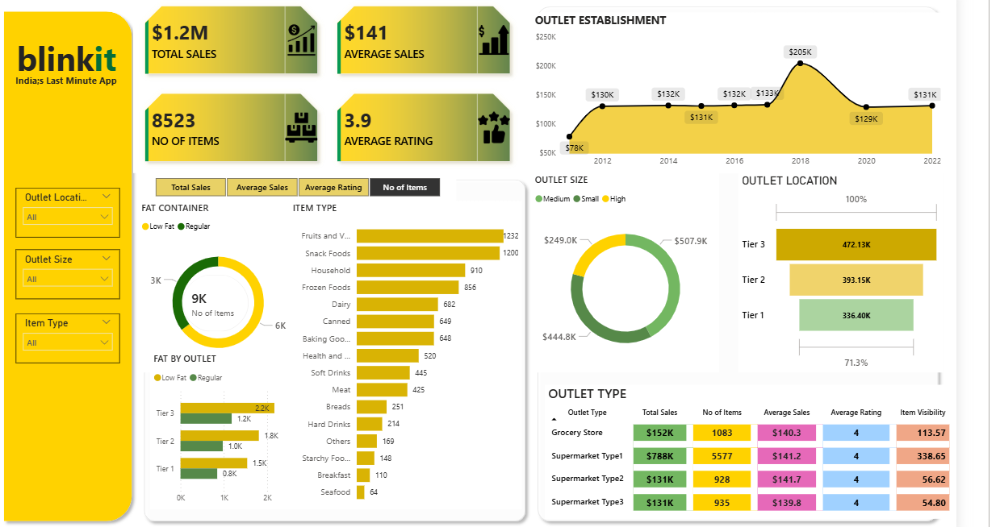

# BLINKIT-DASHBOARD

# 🛒 Blinkit Sales Analysis Dashboard | Power BI

An interactive retail analytics dashboard developed using **Microsoft Power BI, DAX, and data preparation techniques** to analyze sales performance, product categories, outlet characteristics, and customer ratings. The dashboard transforms retail data into actionable visual insights to support business reporting and data-driven decision-making.

## 📌 Table of Contents

- Project Overview
- Business Problem
- Project Objectives
- Tech Stack
- Dataset and Data Preparation
- Dashboard Features
- Key Business Questions
- Business Insights
- DAX Measures and Calculations
- Power BI Concepts Demonstrated
- Interview Questions and Answers
- Dashboard Validation Checklist
- How to Use the Dashboard
- Project Structure
- Future Improvements
- Skills Demonstrated

## 1. 📊 Project Overview

The Blinkit Sales Analysis Dashboard provides an interactive overview of retail sales across item categories, fat-content groups, outlet sizes, outlet locations, and outlet types.

It combines KPI cards, trend analysis, donut charts, bar charts, slicers, and a summary table to help users understand sales distribution and compare outlet performance.

**Project type:** Data Analytics / Business Intelligence  
**Industry:** Retail and Quick Commerce  
**Primary tool:** Microsoft Power BI Desktop  
**Analytical focus:** Sales Performance, Product Analysis, Outlet Analysis, KPI Reporting, and Customer Ratings

### Key dashboard metrics

| KPI | Displayed value |
|---|---:|
| Total Sales | $1.2M |
| Average Sales | $141 |
| Number of Items | 8,523 |
| Average Rating | 3.9 |

*These are the values displayed in the screenshot. Verify the underlying dataset, currency, and measure definitions before presenting them as independently validated results.*

## 2. 🎯 Business Problem

Retail businesses need to understand which products contribute most to sales, how different outlet formats perform, and whether outlet location, size, or product characteristics are associated with differences in sales.

Raw transactional data makes it difficult to identify these patterns quickly without consistent aggregation and visual reporting.

The objective of this project is to create an interactive dashboard that consolidates key retail performance indicators and allows users to investigate sales across multiple business dimensions.

### Project objectives

- Monitor total sales, average sales, item counts, and average ratings.
- Compare sales across different item types.
- Analyze sales distribution by fat content.
- Compare outlet performance by outlet type and size.
- Examine sales across location tiers.
- Explore sales trends by outlet establishment year.
- Enable interactive filtering using outlet location, outlet size, and item type.
- Present key metrics in a clear format for business analysis.

## 3. 🛠️ Tech Stack

- **Microsoft Power BI Desktop:** Dashboard creation, report design, interactive visuals, and KPI monitoring.
- **DAX (Data Analysis Expressions):** Aggregations, measures, calculated metrics, and filter-aware calculations.
- **Microsoft Excel:** Source-data inspection, validation, and preparation, where used.
- **Power Query:** Data cleaning, transformation, and data-type management, where used.
- **Data Visualization:** KPI cards, line charts, bar charts, donut charts, and matrix/table visuals.
- **Data Modeling:** Relationships, aggregation logic, and filter propagation, where applicable.

**Project output:** Power BI report (`.pbix`) and dashboard screenshot (`.png`).

## 4. 📂 Dataset and Data Preparation

The dashboard appears to use a Blinkit-style retail sales dataset containing product and outlet attributes.

The visible fields in Power BI include:

- Item Identifier
- Item Type
- Item Fat Content
- Item Visibility
- Item Weight
- Sales
- Rating
- Outlet Identifier
- Outlet Establishment Year
- Outlet Size
- Outlet Location Type
- Outlet Type

The actual source file and its origin should be documented in the repository once confirmed.

### Data preparation workflow

1. Import the source dataset into Power BI.
2. Inspect the data structure, column types, missing values, and duplicate records.
3. Standardize categorical values, particularly fat-content labels and outlet attributes.
4. Check numeric fields such as Sales, Rating, Item Weight, and Item Visibility.
5. Validate whether missing values require replacement, exclusion, or separate treatment.
6. Create DAX measures for the required KPIs.
7. Build visuals using the appropriate categorical and numerical fields.
8. Configure slicers and visual interactions.
9. Reconcile dashboard results against the underlying dataset.

*Document only the preparation steps you actually performed. Do not claim that missing values or duplicate records were cleaned unless you verified and handled them.*

## 5. 📈 Dashboard Features and Visual Walkthrough

### A. KPI Cards — Overall Sales Performance

The dashboard displays four headline indicators:

| KPI | Business purpose |
|---|---|
| Total Sales | Measures the total recorded sales value |
| Average Sales | Summarizes the average sales metric |
| No. of Items | Displays the item count according to the measure used |
| Average Rating | Summarizes the recorded rating values |

These indicators give users a quick overview before they investigate the detailed visuals.

**Business question:** What is the overall sales performance, and how does it vary when different outlet or product filters are applied?

### B. Outlet Establishment — Sales Trend Analysis

A line-and-area chart compares sales across outlet establishment years.

The screenshot shows a peak of approximately **$205K in 2018**, followed by lower displayed values in later years.

**What it helps analyze:**
- How sales vary across establishment-year groups.
- Which establishment years have the highest recorded sales.
- Whether particular outlet cohorts warrant further investigation.

**Business application:** Retail managers can use this comparison to investigate whether outlet cohorts differ in sales performance.

**Important:** This chart compares sales by establishment year; it does not automatically represent year-over-year sales growth. The establishment year of an outlet is different from the year in which a transaction occurred.

### C. Fat Content — Sales Distribution

A donut chart compares sales associated with the two displayed fat-content groups: **Low Fat** and **Regular**.

**What it helps analyze:**
- How total sales are distributed between the groups.
- Whether one group contributes more sales value.
- Whether the distribution changes with the selected outlet filters.

**Business application:** This analysis can support product-mix reviews and further investigation of sales patterns by product attributes.

Sales differences alone do not establish customer preferences or explain why a category performs differently.

### D. Item Type — Category-Level Sales

A horizontal bar chart ranks product categories by sales.

Visible categories include Fruits and Vegetables, Snack Foods, Household, Frozen Foods, Dairy, Canned, Baking Goods, Health and Hygiene, Meat, Soft Drinks, Breads, Hard Drinks, Others, Starchy Foods, Breakfast, and Seafood.

The screenshot shows Fruits and Vegetables and Snack Foods among the leading categories, at approximately $0.18M each.

**What it helps analyze:**
- Which categories generate the most sales.
- Which categories contribute relatively little.
- How category rankings change under different filters.

**Business application:** Category-level sales analysis can inform inventory reviews, assortment planning, and promotional investigations.

### E. Outlet Size — Sales Comparison

A donut chart compares the outlet-size groups shown in the report: Small, Medium, and High.

**What it helps analyze:**
- How sales are distributed across outlet-size categories.
- Whether sales contribution differs across outlet sizes.
- Whether outlet size is associated with sales differences.

**Business application:** This comparison can help identify outlet groups for further operational analysis.

Confirm the exact field values and visual aggregation in the report. A donut chart should show a meaningful sales distribution, and its percentages should reconcile with the underlying sales total.

### F. Outlet Location — Tier-Level Sales

A horizontal bar chart compares sales across three outlet-location tiers.

| Outlet location tier | Displayed sales |
|---|---:|
| Tier 3 | 472.13K |
| Tier 2 | 393.15K |
| Tier 1 | 336.40K |

**What it helps analyze:**
- Which location tier contributes the most sales.
- How sales differ between location tiers.
- Whether the ranking changes when filters are applied.

**Business application:** The results can support location-based performance reviews.

However, total sales alone do not establish which tier is most profitable. Outlet counts, costs, and average performance per outlet may also be needed.

### G. Outlet Type — Detailed Performance Table

The table compares outlet types using multiple metrics, including Total Sales, Number of Items, Average Sales, Average Rating, and Item Visibility.

Selected values visible in the screenshot include:

| Outlet type | Total sales | No. of items | Average sales | Average rating |
|---|---:|---:|---:|---:|
| Supermarket Type1 | $788K | 5,577 | $141.2 | 4 |
| Grocery Store | $152K | 1,083 | $140.3 | 4 |
| Supermarket Type3 | $131K | 935 | $139.8 | 4 |
| Supermarket Type2 | $131K | 928 | $141.7 | 4 |

*Values are transcribed from the screenshot and may be rounded.*

**What it helps analyze:**
- How recorded sales differ across outlet formats.
- How item counts vary by outlet type.
- Whether average sales and ratings differ across formats.
- How item visibility varies across outlet types.

**Business application:** The table allows a more detailed comparison than a single KPI or chart because several metrics can be reviewed together.

A high total sales figure may partly reflect having more outlets or more recorded items. For a fair comparison, examine average sales per outlet and other normalized metrics where the required data is available.

### H. Interactive Slicers — Outlet and Product Filtering

The dashboard includes slicers for:

- Outlet Location
- Outlet Size
- Item Type

These filters allow users to narrow the report to a particular location tier, outlet-size group, or product category.

**Business benefit:** Users can investigate specific segments without needing separate static reports.

The slicers should be tested to ensure they affect the intended visuals and do not produce misleading comparisons.

## 6. 🔍 Key Business Questions

The dashboard is designed to investigate these retail questions:

1. What is the total sales value across the selected data?
2. What is the average sales value, and how exactly is it calculated?
3. How many items are recorded in the dataset?
4. What is the average product rating?
5. Which item types contribute the highest sales?
6. Which categories contribute the lowest sales?
7. How do sales differ between Low Fat and Regular products?
8. Which outlet-size group contributes the most sales?
9. Which location tier has the highest total sales?
10. How do sales compare across outlet types?
11. Which outlet type has the highest number of recorded items?
12. Does average sales differ meaningfully across outlet formats?
13. Which establishment-year group has the highest sales?
14. How does the dashboard change when a specific item type is selected?
15. Do outlet-size and location filters affect all intended visuals?
16. Is a higher total sales value caused by better average performance or simply a greater number of outlets?
17. How does item visibility vary by outlet type?
18. Are sales and item-count measures consistent with the underlying source data?

These are investigation questions. The actual dataset and validated calculations determine the answers.

## 7. 💡 Business Insights and Applications

The visible dashboard suggests several areas worth investigating:

- **Category analysis:** Fruits and Vegetables and Snack Foods appear among the highest-selling categories in the displayed report.
- **Outlet performance:** Supermarket Type1 has the largest displayed total sales among the outlet types shown.
- **Location analysis:** Tier 3 has the highest displayed total sales among the three location tiers.
- **Establishment-year analysis:** The chart displays a peak around 2018, which may warrant investigation of outlet cohort differences.
- **Product segmentation:** The fat-content chart supports comparisons of sales distribution between Low Fat and Regular products.
- **Rating monitoring:** The average rating KPI offers a headline measure of recorded ratings, although a single average can hide differences across categories.

### Potential business applications

**Inventory planning:** Use category-level sales to identify products requiring closer demand and stock analysis.

**Outlet management:** Compare outlet types and location tiers to identify differences in sales performance.

**Product strategy:** Investigate whether product attributes are associated with sales differences.

**Performance reporting:** Use KPI cards and slicers to monitor selected segments.

**Further analysis:** Combine sales with costs, inventory availability, outlet counts, and time-based transaction data to investigate profitability and operational efficiency.

These are potential applications, not proof that the dashboard has already increased sales, reduced costs, or improved profitability.

## 8. 🧮 DAX Measures and Calculations

The following are example DAX patterns for a dataset with a table named `Blinkit`. Replace the table and column names with the actual names in your Power BI model.

### Total Sales

```dax
Total Sales =
SUM ( Blinkit[Sales] )
```

Aggregates the sales amount across the current filter context.

### Average Sales per Record

```dax
Average Sales =
AVERAGE ( Blinkit[Sales] )
```

Calculates the arithmetic mean of the Sales column. Use this only if it matches the intended definition of the dashboard's Average Sales KPI.

### Number of Items

```dax
No of Items =
COUNTROWS ( Blinkit )
```

Counts rows in the table. This represents the number of records, not necessarily the number of distinct products or physical units sold.

If each row represents a unique item identifier, a distinct-count measure may be more appropriate:

```dax
Distinct Items =
DISTINCTCOUNT ( Blinkit[Item Identifier] )
```

The correct measure depends on the dataset's grain and what the dashboard is intended to count.

### Average Rating

```dax
Average Rating =
AVERAGE ( Blinkit[Rating] )
```

Calculates the average of the numeric rating values, excluding blanks from the arithmetic mean.

### Total Sales by Item Type

```dax
Sales by Item Type =
[Total Sales]
```

Place Item Type on the chart axis and this measure in Values. Power BI evaluates the measure separately for each category using filter context.

### Sales by Outlet Type

```dax
Sales by Outlet Type =
[Total Sales]
```

Place Outlet Type in the table or chart category field and use the measure to compare outlet formats.

### Sales per Outlet

If the dataset contains a reliable outlet identifier:

```dax
Sales per Outlet =
DIVIDE (
    [Total Sales],
    DISTINCTCOUNT ( Blinkit[Outlet Identifier] ),
    0
)
```

This calculates average sales per distinct outlet in the current filter context. It can help compare segments of different sizes, but it should be interpreted carefully when filters or missing outlet identifiers affect the denominator.

### Sales Percentage of Total

```dax
Sales % of Total =
DIVIDE (
    [Total Sales],
    CALCULATE (
        [Total Sales],
        REMOVEFILTERS ( Blinkit[Item Type] )
    ),
    0
)
```

This example calculates sales as a percentage of the total after removing the Item Type filter while retaining other filters. Adapt the filter removal to the dimension being analyzed and the intended denominator.

### Why use measures?

Measures recalculate dynamically according to the report's filter context. For example, selecting a particular outlet size changes the sales measure for visuals connected to that filter.

**Note:** These are illustrative formulas, not verified copies of the formulas implemented in the report. Check the existing measures in the Power BI Fields pane before describing them as your implementation.

## 9. 🧠 Power BI Concepts Demonstrated

### Measures versus calculated columns

- **Measure:** Evaluated according to the current filter context; appropriate for Total Sales and Average Rating.
- **Calculated column:** Evaluated row by row and stored in the model; useful for classifications or row-level attributes.

### Filter context

Filter context determines which rows contribute to a calculation. Selecting Grocery Store or a particular item type changes the relevant totals when the visuals and model are configured correctly.

### Power Query versus DAX

- **Power Query:** Primarily prepares and transforms data before it enters the model.
- **DAX:** Calculates measures and other model expressions during analysis.

### Aggregation

`SUM`, `AVERAGE`, `COUNTROWS`, and `DISTINCTCOUNT` answer different questions. Choosing the wrong aggregation can create a misleading KPI.

### Data modeling

Relationships determine how filters propagate between tables. Even a visually attractive report can produce incorrect results if its relationships or table grain are inappropriate.

## 10. 🎤 Interview Preparation — Questions and Answers

### Project explanation and business understanding

**Q1. Explain your Blinkit dashboard in 60 seconds.**

**Answer:**  
"I developed a retail sales analytics dashboard in Power BI to explore sales performance across product categories, fat-content groups, outlet sizes, location tiers, and outlet types. The report uses KPI cards to summarize overall performance, charts to compare sales patterns, and slicers to investigate specific segments. I focused on turning retail data into an interactive reporting solution that helps users compare categories and outlets and identify areas requiring further analysis."

**Q2. What business problem does your dashboard solve?**

It reduces the effort required to investigate retail performance across multiple dimensions. Instead of reviewing raw records manually, a user can compare categories, outlets, and location segments through interactive visuals.

**Q3. Why did you choose Power BI?**

Power BI supports data preparation, DAX calculations, interactive visualization, and report-level filtering in one platform. It is well suited to building reusable business intelligence reports.

**Q4. Who would use this dashboard?**

Retail analysts, business analysts, sales managers, and outlet operations teams could use it to review sales distribution and investigate segment-level performance.

**Q5. What is the most important insight from the screenshot?**

Supermarket Type1 has the highest displayed total sales among the outlet types shown, while Tier 3 has the highest displayed total sales among the location tiers. These findings describe the visible totals; they do not establish the highest profitability or best per-outlet performance.

### DAX and calculations

**Q6. What is DAX?**

DAX stands for Data Analysis Expressions. It is used in Power BI to create measures, calculated columns, and calculated tables.

**Q7. What is the difference between SUM and AVERAGE?**

`SUM` adds values in a numeric column. `AVERAGE` calculates their arithmetic mean. Total sales and average sales therefore answer different questions.

**Q8. What is the difference between COUNTROWS and DISTINCTCOUNT?**

`COUNTROWS` counts table rows. `DISTINCTCOUNT` counts unique values in a specified column. If one product appears on multiple rows, these calculations can produce different results.

**Q9. Why use DIVIDE instead of the `/` operator?**

`DIVIDE` handles division by zero or a blank denominator more safely and allows an alternative result to be specified.

**Q10. What is the difference between a measure and a calculated column?**

A measure is evaluated dynamically in filter context. A calculated column produces a value for each row and is stored in the data model.

**Q11. What is CALCULATE used for?**

`CALCULATE` evaluates an expression in a modified filter context. It is commonly used for filtered totals, percentage-of-total calculations, and time-intelligence measures.

**Q12. What is filter context?**

Filter context is the set of filters applied to a calculation by slicers, visual categories, report filters, and DAX expressions.

**Q13. What is row context?**

Row context refers to the current row being evaluated in a calculated column or during an iterator such as `SUMX`.

**Q14. What is the difference between SUM and SUMX?**

`SUM` adds one numeric column. `SUMX` iterates over a table, evaluates an expression for each row, and adds the results.

**Q15. How would you calculate sales as a percentage of total?**

Divide the sales measure for the current segment by a total calculated with the relevant category filter removed. The denominator must retain or remove the intended filters.

### Data cleaning and modeling

**Q16. How would you handle missing Item Weight values?**

First, quantify the missing values and determine whether they affect the analysis. Depending on the purpose, I might retain blanks, investigate a source correction, use a defensible imputation method, or exclude affected rows from a specific analysis. I would document the choice rather than automatically replacing every missing value with the mean.

**Q17. How would you handle inconsistent fat-content labels?**

Inspect distinct values, standardize equivalent categories in Power Query, and verify that the cleaned groups match the intended business definitions.

**Q18. How would you identify duplicate records?**

Check candidate keys and the dataset's grain. Identical-looking rows are not necessarily duplicates, so I would verify whether the combination of fields should uniquely identify a record before removing anything.

**Q19. What is data granularity?**

Granularity describes what one row represents. A row might represent a product, an outlet-product combination, or a transaction. Understanding this is essential for choosing correct counting and aggregation measures.

**Q20. What is the purpose of a date table?**

A date table provides a consistent calendar dimension for time-based analysis, including month, quarter, year, and time-intelligence calculations. It is particularly useful when transaction dates are available.

**Q21. What is a star schema?**

A star schema organizes a data model around a fact table containing measurable events and dimension tables describing attributes such as products, outlets, and dates.

**Q22. What is the difference between Power Query and DAX?**

Power Query transforms data during preparation and refresh. DAX calculates measures and model expressions for analysis. Both are useful, but they solve different problems.

### Visualizations and dashboard design

**Q23. Why use a bar chart for item types?**

A horizontal bar chart is effective for comparing many category values because category labels remain readable and values can be ranked easily.

**Q24. Why use a donut chart for fat content?**

It provides a compact view of each category's share of a total. If exact comparisons are important or the values are very close, a bar chart may be clearer.

**Q25. What does the outlet-establishment chart actually show?**

It compares the sales values associated with outlet establishment-year groups. It does not automatically show transaction-year growth or changes in sales over time.

**Q26. What are slicers in Power BI?**

Slicers are interactive controls that filter report data. This dashboard uses outlet location, outlet size, and item type to support segment-based analysis.

**Q27. What is cross-filtering?**

Cross-filtering occurs when a selection in one visual filters related data in another visual. The exact behavior depends on visual interaction settings and model relationships.

**Q28. What is drill-through?**

Drill-through lets users navigate from a summary visual to a detail page filtered for a selected category or entity, provided the report has been configured for it.

**Q29. Why use a table alongside charts?**

A table displays several metrics together, making it useful for detailed comparisons across outlet types. Charts are usually better for quickly recognizing trends and relative differences.

**Q30. How would you improve the dashboard layout?**

I would prioritize the KPIs, maintain consistent units and number formats, check label readability, standardize spacing and colors, provide informative tooltips, and ensure filters are intuitive. I would also verify that the report works well at its intended display size.

### Business interpretation and critical thinking

**Q31. Does the outlet with the highest sales necessarily perform best?**

No. Total sales depend on factors such as outlet count, size, product mix, and sales volume. Comparing sales per outlet, profit margin, and operating costs can provide a fairer assessment.

**Q32. Can you conclude that customers prefer Low Fat products if their sales are higher?**

Not from sales alone. Differences may reflect product availability, price, outlet distribution, or other factors. Sales distribution is evidence of recorded sales, not proof of customer preference or causation.

**Q33. Why might average sales be similar across outlet types while total sales differ significantly?**

Total sales depend on both the number of contributing records or outlets and the sales generated by each. Similar average values can coexist with very different totals.

**Q34. Does a higher average rating always mean better customer satisfaction?**

Not necessarily. The number of ratings, their distribution, and the rating collection process matter. Averages can hide variation and differences in sample size.

**Q35. How would you investigate a sudden sales decline?**

I would check data completeness, compare relevant periods, segment the decline by item type and outlet, and investigate price, stock availability, promotions, and other available explanatory variables.

**Q36. How would you measure outlet efficiency?**

I would first define efficiency and identify the necessary data. Possible measures include sales per outlet, sales per square foot, sales per employee, or profit per outlet, depending on available data.

**Q37. Can this dashboard measure profitability?**

Not with sales data alone. Profitability requires appropriate cost and expense information, and ideally returns, discounts, and other relevant adjustments.

**Q38. How would you validate the $1.2M Total Sales KPI?**

I would independently aggregate the source Sales column, check the applied filters and data types, reconcile the result with Power BI, and confirm the unit and currency formatting.

**Q39. What if a slicer changes the KPI but not the expected chart?**

I would inspect the visual interaction settings, relationships, field assignments, visual-level filters, and whether the chart uses the intended measure.

**Q40. What are the limitations of this dashboard?**

The report summarizes the data provided but does not independently explain causation, profitability, stock availability, or customer behavior. Those questions require additional fields, appropriate comparisons, and validated business definitions.

### Advanced and scenario-based questions

**Q41. How would you calculate month-over-month sales growth?**

With a proper date table and transaction-date relationship, I would calculate current-month sales and prior-month sales, then use `DIVIDE` to calculate the percentage change. I would confirm that the dataset contains sufficient transaction-date coverage.

**Q42. How would you create a dynamic top-five item-type chart?**

I would use a Top N filter based on the Total Sales measure, or create a ranking measure with `RANKX` if more customized ranking behavior is required.

**Q43. What is a many-to-one relationship?**

It is a relationship in which many rows in one table correspond to one row in another table, such as many sales records associated with a single product dimension record.

**Q44. What is the difference between a calculated column and a Power Query custom column?**

A Power Query custom column is calculated during data transformation before loading into the model. A DAX calculated column is calculated in the model during processing or refresh. The choice depends on whether the logic belongs in data preparation or the model.

**Q45. How would you optimize a slow Power BI report?**

I would inspect the model and visual complexity, remove unnecessary columns, reduce high-cardinality fields where appropriate, simplify expensive DAX, optimize relationships, and test performance using Performance Analyzer.

**Q46. What is a KPI, and how is it different from a raw metric?**

A metric is a measurement, such as sales or item count. A KPI is a metric selected to evaluate progress toward a defined business objective, ideally with a target or benchmark.

**Q47. What would you do if two visuals showed different sales totals?**

I would align their filter contexts, check the measures and aggregations, review relationships and hidden filters, and reconcile both results against the same underlying data subset.

**Q48. How would you explain this dashboard to a nontechnical manager?**

I would focus on the business questions it answers, explain the key metrics in plain language, show how to filter outlet and product segments, and distinguish confirmed findings from areas needing further investigation.

**Q49. What would you add if profit data became available?**

I would add total profit, profit margin, profit by outlet type, and profit by item category. I would also compare profitability against sales to identify high-revenue segments that may have low margins.

**Q50. What did you learn from this project?**

A strong answer should reflect your actual experience. For example: "I learned how to organize retail performance indicators into an interactive report, compare sales across categories and outlet segments, and use filters to investigate patterns. I also learned that the usefulness of a dashboard depends on accurate data preparation and correctly defined measures, not just visual design."

## 11. ⚠️ Dashboard Validation Checklist

Before using this project in an interview or portfolio, verify the following:

- [ ] Confirm the original dataset and cite its source.
- [ ] Verify the currency and number formatting used for Sales.
- [ ] Confirm the exact definition of Average Sales.
- [ ] Confirm whether No. of Items counts rows, distinct products, or units.
- [ ] Check whether Average Rating ignores blanks and uses the intended rating field.
- [ ] Verify the outlet-establishment chart's aggregation and interpretation.
- [ ] Check that outlet-size categories and percentages reconcile correctly.
- [ ] Confirm the exact outlet-location tier definitions.
- [ ] Test all slicers and visual interactions.
- [ ] Reconcile displayed totals against the source data.
- [ ] Ensure every DAX formula in the README matches the intended metric.
- [ ] Avoid claiming improvements in revenue, profit, or operational efficiency without evidence.

## 12. 🚀 How to Use the Dashboard

1. Open the `.pbix` file in Power BI Desktop.
2. Review the KPI cards to understand the overall reported metrics.
3. Select an outlet location, outlet size, or item type using the slicers.
4. Compare sales across item categories and outlet establishment years.
5. Explore the fat-content and outlet-size distributions.
6. Compare sales by outlet location and outlet type.
7. Use the table to review sales, item counts, ratings, and visibility together.
8. Reset filters when you want to return to the overall view.

The behavior of individual visuals depends on the report's configured interactions.

## 13. 📁 Suggested GitHub Repository Structure

```text
Blinkit-Sales-Analysis/
├── README.md
├── dashboard/
│   └── BLINKIT_DASHBOARD.pbix
├── images/
│   └── blinkit-dashboard-preview.png
└── data/
    └── README.md
```

Include the dataset only when redistribution is permitted. Otherwise, document the original source and instructions for obtaining it.

## 14. 🔮 Future Improvements

- Add monthly and yearly sales trends if transaction-date data is available.
- Introduce profit and profit-margin analysis if cost data is available.
- Add average sales per outlet to make comparisons fairer.
- Create drill-through pages for detailed outlet analysis.
- Add targets and variance KPIs where business targets are available.
- Improve chart tooltips, accessibility, and visual consistency.
- Document all DAX measures and their business definitions.
- Add data-quality checks and source-to-dashboard reconciliation.

## 15. 👨‍💻 Skills Demonstrated

- Microsoft Power BI
- DAX and KPI calculations
- Data cleaning and preparation
- Exploratory Data Analysis
- Sales performance analysis
- Retail and outlet segmentation
- Interactive data visualization
- Business intelligence reporting
- Data validation and analytical reasoning
- Business communication and insight presentation

---

**Author:** Nilay Ghosh  
**Project:** Blinkit Sales Analysis Dashboard  
**Primary Tool:** Microsoft Power BI  
**Focus Areas:** Data Analytics | Business Intelligence | Retail Sales Analysis
### Screenshots / Demos
Show what the dashboard looks like.
Example: 
*The dashboard metrics and category observations in this README are based on the provided screenshot. Example DAX measures are illustrative; verify the actual data model and calculations before presenting them as the implementation.*
